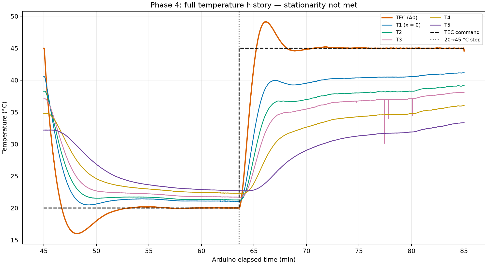

# Step 8: Temperature history and stationary check

**Criterion NOT MET.** No accepted 10-minute stationary interval exists in the saved post-step record. The longest simultaneous passing stretch is 0.00 s.

| Sensor | Final temperature (°C) | Final trailing-2-minute drift (°C/min) |
|---|---:|---:|
| TEC (A0) | 44.56 | -0.0097 |
| T1 (x = 0) | 41.15 | +0.0994 |
| T2 | 39.12 | +0.1079 |
| T3 | 38.10 | +0.1517 |
| T4 | 36.02 | +0.1964 |
| T5 | 33.34 | +0.2629 |

A temperature profile cannot be labeled stationary solely from the last readings. Farther sensors respond later because heat must diffuse farther through the rod, and their changes are smaller because heat is lost along the side surface. The plot includes the entire recorded cooling/baseline and heating history; the command and measured TEC response should be assessed for overshoot rather than presumed non-oscillatory.

