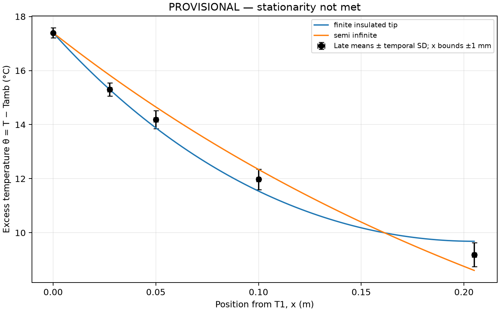

# Step 3: Excess-temperature profile

T1 supplies the boundary excess; TEC A0 is not a rod-profile point. Horizontal bars are conservative position bounds; vertical bars show temporal scatter only. Shared ambient uncertainty is not included because it was not measured.
