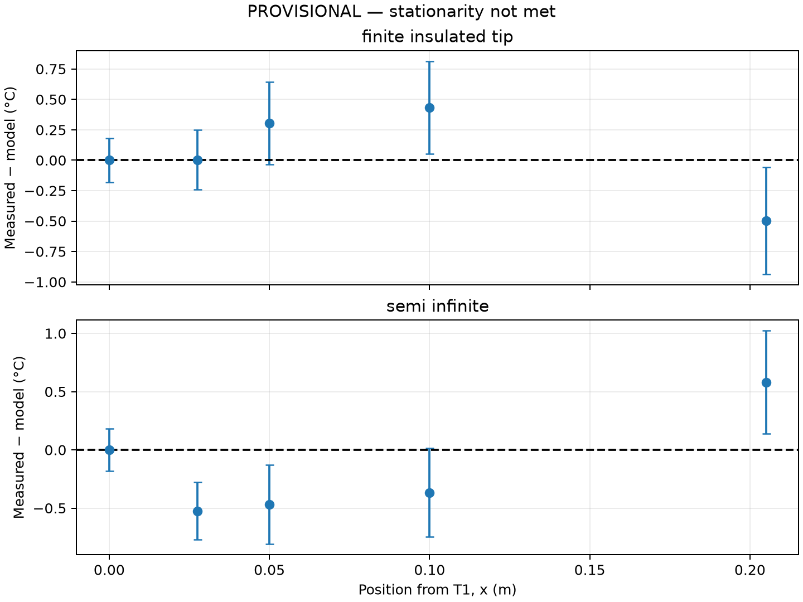

# Step 5: Residuals and fitted m

[Residual values](../../data/module_07/phase_5/model_residuals.csv); [parameters](../../data/module_07/phase_5/fit_parameters.csv). Residual = measured minus model.

- finite_insulated_tip: **m = 5.8085 ± 0.1813 m⁻¹**; T2–T5 RMSE = 0.3634 °C.
- semi_infinite: **m = 3.4340 ± 0.2452 m⁻¹**; T2–T5 RMSE = 0.4916 °C.

± values are conditional approximate one-standard-error regression estimates from residual variance and a linearized Jacobian (4 nonbase residuals, 1 parameter, 3 degrees of freedom). They condition on fixed base, ambient, and positions; they are NOT total measurement uncertainties or validated confidence intervals. Nonstationarity, correlated sensor error, and model mismatch limit their interpretation.
